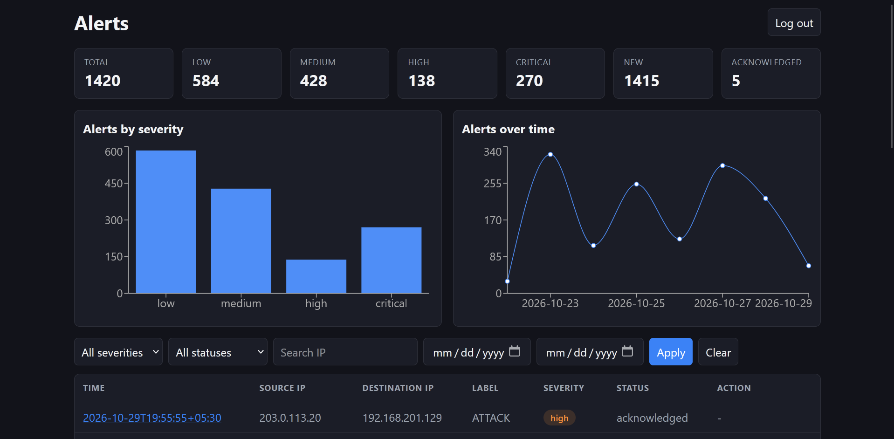
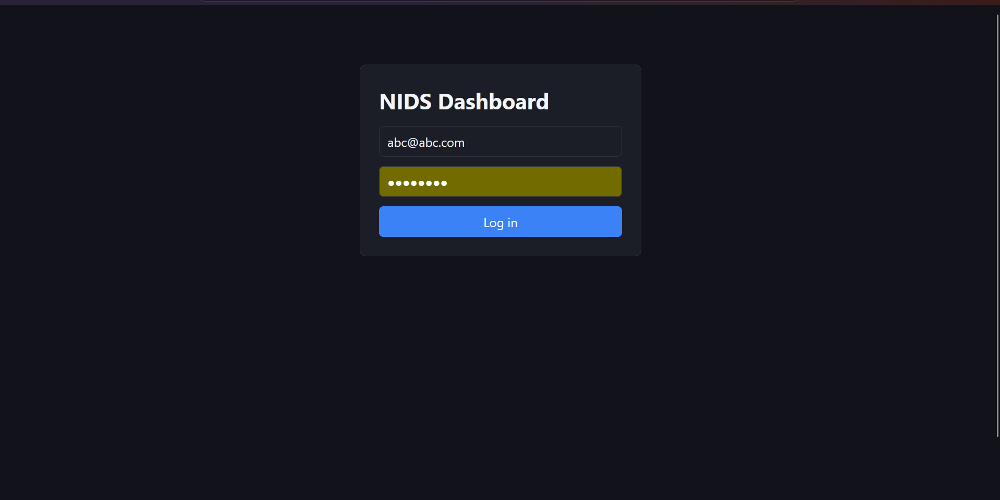
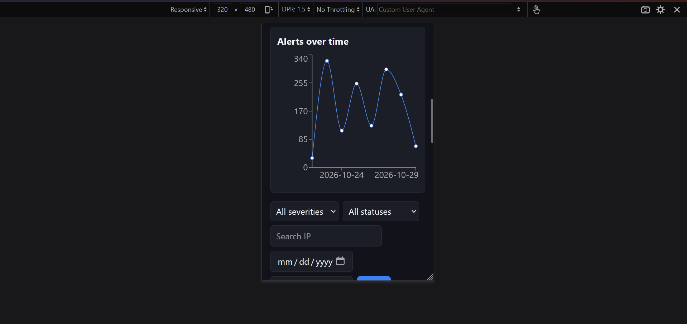
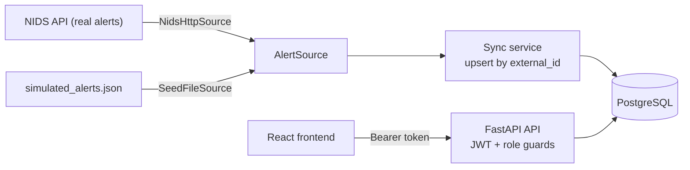

# nids-dashboard

A full-stack security alert dashboard. It stores network intrusion alerts, lets analysts filter and acknowledge them, and lets admins manage users and sync new alerts. It consumes the alerts produced by my [Network Intrusion Detection System](<NIDS REPO URL>).

**Live demo:** https://nids-dashboard-5bcj.onrender.com
Demo analyst account: `a@a.com` / `12345678`
The demo runs on **simulated alerts** (labelled as such in the data file), not real network traffic. It is hosted on free tiers, so the first load can take about a minute while the server wakes up.



| Login | Mobile |
|---|---|
|  |  |

## Features

- Alert list with filters (severity, status, date range, IP search) and pagination, all run in SQL
- Alert detail, acknowledge with a note, stats cards and charts (alerts over time, by severity)
- JWT login with two roles: `analyst` (view, filter, acknowledge) and `admin` (plus user management and sync)
- Admin "Sync" pulls alerts from the configured source; running it twice never creates duplicates
- 12 REST endpoints, unified error format, request logging, rate-limited login
- 25 automated tests, GitHub Actions CI, Docker Compose, deployed on Render and Neon

## Architecture



The `AlertSource` abstraction has two implementations. `NidsHttpSource` calls the real NIDS API. `SeedFileSource` reads simulated alerts and is what the deployed demo uses, because live packet capture cannot run on a cloud host. The sync service upserts by a unique `external_id`, which is what makes it idempotent.

## Stack

FastAPI, SQLAlchemy 2.0, Alembic, PostgreSQL, PyJWT, Argon2 (pwdlib), slowapi, React, Vite, React Router, Recharts, pytest, Docker Compose, GitHub Actions, Render, Neon.

## Documentation

- [API specification](docs/API_SPEC.md): every endpoint, errors, role permissions, severity rule
- [ER diagram](docs/ER_DIAGRAM.md)

## Run locally

Requirements: Python 3.13, Node, PostgreSQL.

```bash
# backend
cd backend
python -m venv .venv
# Windows: .\.venv\Scripts\Activate.ps1    macOS/Linux: source .venv/bin/activate
pip install -r requirements.txt
cp .env.example .env        # then fill in the values
alembic upgrade head
uvicorn app.main:app --reload    # http://localhost:8000/docs
```

```bash
# frontend (second terminal)
cd frontend
npm install
npm run dev                      # http://localhost:5173
```

Create the first admin with `python scripts/bootstrap_admin.py` (run from `backend/`). Public registration only ever creates analysts. To load data, set `ALERT_SOURCE=seed` and `SEED_FILE=../docs/simulated_alerts.json`, log in as admin and use Sync.

Tests (from `backend/`): `python -m pytest -q`. They run against a separate throwaway PostgreSQL database.

Docker: `docker compose up --build` starts the database, backend and frontend.

## Security and threat model

| Threat | Risk | Mitigation in this project |
|---|---|---|
| Brute-force login | Attacker guesses passwords | Login limited to 5 attempts/minute per IP (slowapi); Argon2id makes each guess expensive; identical error for unknown email and wrong password prevents account enumeration |
| Token theft | Stolen JWT lets an attacker act as the user | Tokens expire after 30 minutes; role is re-read from the database on each request, so demotions apply immediately; HTTPS required in deployment. Known limit: the React app stores the token in localStorage, which is readable by XSS (httpOnly cookies are the alternative) |
| Injection | Malicious input reaches the database | SQLAlchemy parameterised queries; Pydantic validates all request bodies; filter values are restricted with Literal types; the search term is escaped |
| CORS misconfiguration | A malicious site calls the API from a victim's browser | Only the configured frontend origin is allowed, with explicit methods and headers, no wildcard. CORS is a browser control only, so every route still enforces authentication and roles |
| Secrets exposure | Leaked signing key or database password | SECRET_KEY and DATABASE_URL come from environment variables; .env is git-ignored; .env.example holds placeholders only; the admin password is read with getpass |
| Privilege escalation | A user makes themselves admin | Public registration always creates analysts; admins come only from a bootstrap script; role changes are admin-only, and admins cannot change their own role |

Other controls: role checks run on the server (`401` without a token, `403` for the wrong role), and hiding buttons in the UI is only a convenience. Request logs exclude tokens, headers and bodies.

### Security limitations
- Rate-limit counters are in memory and reset on restart (Redis would fix this at scale).
- No refresh tokens or token revocation; a stolen token works until it expires.
- Limiting by IP can lock out users behind a shared IP.

### Frontend token storage

The frontend keeps the JWT in `localStorage` so a page refresh does not log the user out. Any JavaScript running on the page can read `localStorage`, so a cross-site scripting (XSS) bug could expose the token. Mitigations in place: tokens expire after 30 minutes, and React escapes rendered values by default.

A stronger alternative is an `httpOnly`, `Secure`, `SameSite` cookie set by the backend, which page scripts cannot read. It would also need CSRF protection and credentialed CORS, so it is listed as future work.

## Known limits

- Severity is a documented heuristic (target service plus a burst rule), not a model output
- The underlying NIDS model was trained on KDD Cup 99 and validated only against Nmap SYN scans. It mislabelled two port-53 probes as NORMAL and has not been validated on other attacks or on normal modern traffic
- The deployed demo uses simulated data, not live capture
- Rate-limit counters are kept in memory (Redis would be needed with several servers)
- CORS only restricts browsers; it does not stop other HTTP clients
- The over-time chart groups by UTC day
- If the alert source is unreachable, sync currently fails with a plain 500; a catch-all error handler is not implemented yet
- Free hosting: Render sleeps when idle (about a minute to wake) and Neon suspends after 5 idle minutes
- Monitoring a network requires the owner's consent

## Planned next (not built yet)

1. A small sensor program that runs on a machine, builds flow features and sends them to the hosted API, with a live feed in the dashboard
2. A detection model trained on a modern flow dataset (CIC-IDS2017 or UNSW-NB15), with measured false-positive rates on normal traffic
3. Incident grouping and confirmed / false-positive marking
4. Per-user data isolation so several people can use one deployment
5. Smaller items: TanStack Query, httpOnly cookies, Redis rate limiting, notifications for high-severity alerts