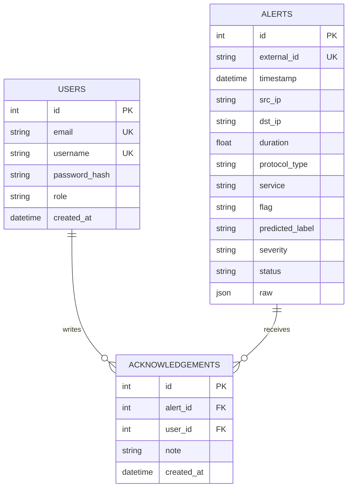

# Data model

## Notes

- `external_id` is `"<run label>-<NIDS id>"`, where the run label is the timestamp of the first alert in the NIDS database. Syncing the same database twice updates rows instead of duplicating them, and a recreated `nids.db` gets a new label, so old and new alerts never collide.
- `severity` is assigned at sync time by the triage rule in `API_SPEC.md`.
- `raw` keeps the original NIDS record as JSON.
- Indexes (added on Day 4) go on the columns the dashboard filters by: `severity`, `status`, `timestamp`, `src_ip`.